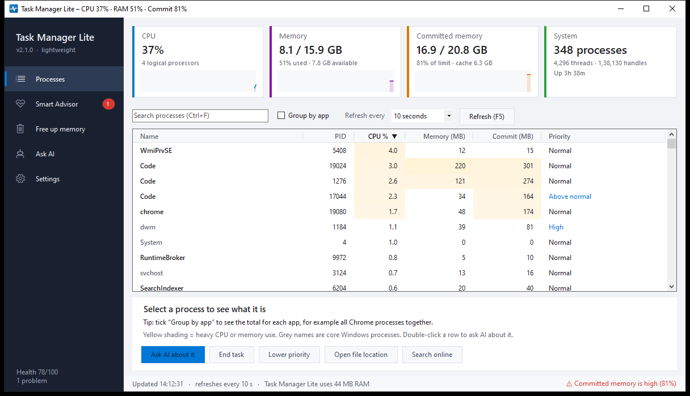

# Task Manager Lite

A lightweight task manager for Windows with a **Smart Advisor**, **Ask AI** (powered by Claude Code), **automatic troubleshooting**, **memory cleanup** and **self-update**, and it uses only about **45 MB of RAM** itself.

Built for PCs that run many heavy apps at once (VS Code, AI assistants, browsers, trading web apps) and need to stay smooth.



## Features

| | |
|---|---|
| **Processes** | CPU, RAM and committed-memory tiles with history graphs. Process list with heat shading, sort, search and **Group by app**. A details panel explains what each process is and whether it's safe to end. |
| **Smart Advisor** | Offline health score (0–100) with fixes for: memory nearly full, sustained high CPU, apps not responding, memory leaks, low disk space, a small page file, and more. |
| **Ask AI** | Ask questions such as "Why is my PC slow?" and get answers from Claude based on a live snapshot. Claude can't run commands or change anything. |
| **Priority apps** | Your own list of apps with a fixed priority (High, Above normal, Below normal or Low), with **Add / update** and **Delete**, or right-click a process → *Add to priority apps*. Apps you raise get the CPU first and are never auto-lowered or trimmed. Chrome (for Quantman) is the default. |
| **Auto-troubleshoot** | Optional: tray alerts, lowering the priority of background CPU hogs, applying your priority apps, and trimming background apps when RAM is above 85%. Every action is logged. |
| **Free up memory** | Memory composition bar, **Trim background apps**, **Clear cached memory** (admin), and junk-file cleanup (temp files, crash dumps, error reports, Recycle Bin). |
| **Self-update** | Rebuilds itself from `src\` when the version number in the source goes up. |
| **Comfort** | Light, dark or match-Windows theme, tray icon, start with Windows, single instance, remembered settings. |

More screenshots: [Smart Advisor](docs/screenshots/smart-advisor.png) · [Ask AI](docs/screenshots/ask-ai.png) · [Free up memory](docs/screenshots/free-up-memory.png)

## Requirements

- Windows 10 or 11, 64-bit
- .NET Framework 4.8 (already built into Windows 10 1903+ and Windows 11)
- Optional, for Ask AI: [Claude Code](https://claude.com/claude-code), installed and signed in

## Install

1. Download `TaskManagerLite-v2.2.0-win-x64.zip` from **Releases**.
2. Extract it to a folder in your user profile, for example `%USERPROFILE%\Tools\TaskManagerLite`.
3. Run `TaskManagerLite.exe`. The program isn't code-signed, so Windows SmartScreen may warn you: choose **More info → Run anyway**.

Keep the `src` folder next to the program; self-update and **Rebuild now** use it.

## Build from source

No Visual Studio is needed. Windows already includes the C# compiler.

```bat
build.bat
```

This produces `TaskManagerLite.exe` in the same folder.

## Usage

See the **[User Guide](docs/USER-GUIDE.md)**. Quick keys: **F5** refreshes, **Ctrl+F** searches, **Delete** ends the selected task, and double-clicking a row asks AI about it.

Command line: `--page N` (0 Processes, 1 Advisor, 2 Ask AI, 3 Settings, 4 Free up memory), `--ask "question"`, `--minimized`.

## Privacy and security

- No telemetry, no accounts, no background network traffic.
- **Ask AI** sends a snapshot (process names and resource numbers) to Anthropic through **your own** Claude Code sign-in, only when you ask. Details: [PRIVACY.md](PRIVACY.md).
- Core Windows processes are protected from being ended. Admin rights are requested only to clear cached memory. Details: [SECURITY.md](SECURITY.md).

## Uninstall

Untick **Start with Windows** in Settings (if you ticked it), close the app, and delete its folder. Nothing else is installed.

## License

[MIT](LICENSE) © 2026 Vk Professional Service

## Disclaimer

This is an independent project and is not affiliated with Microsoft, Google, Anthropic, OpenAI or Quantman. Product names are used only to describe compatibility. "Task Manager Lite" is not the Windows Task Manager. Freeing or clearing memory can make apps reload data; use these features at your own discretion.
